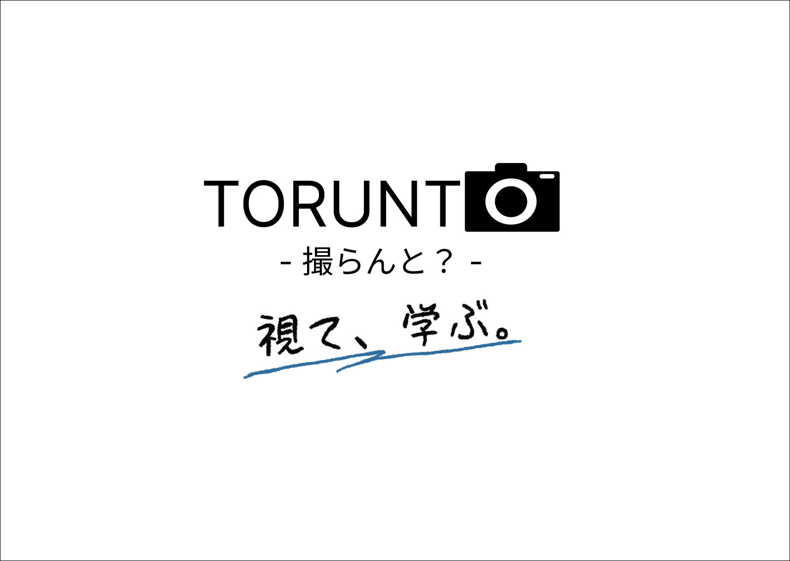
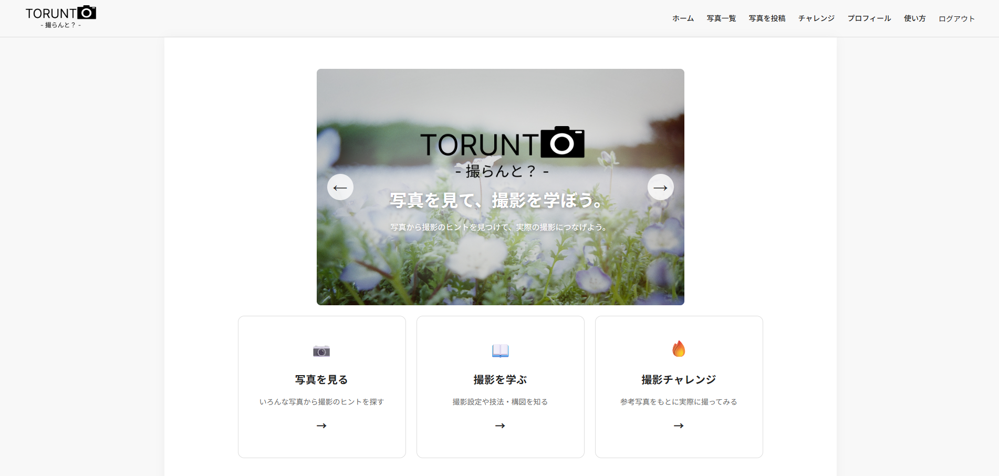
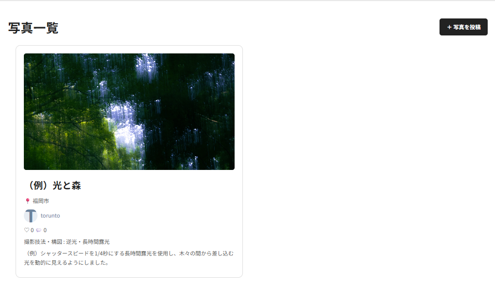
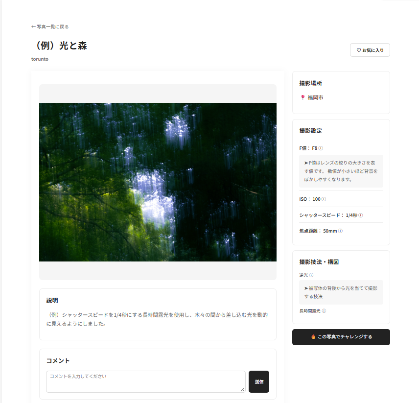
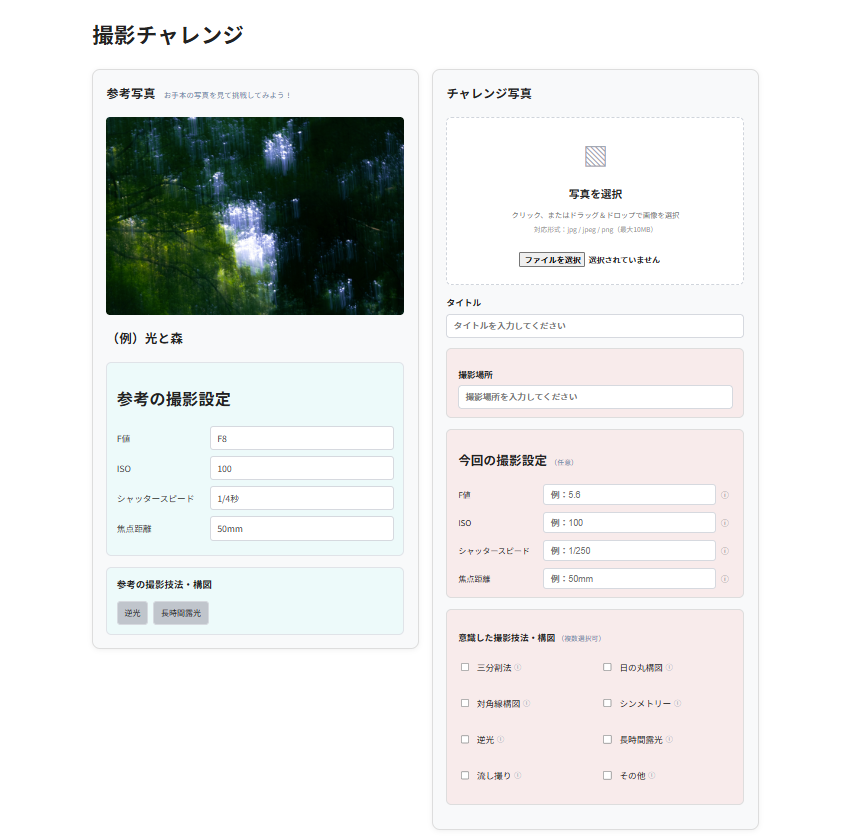
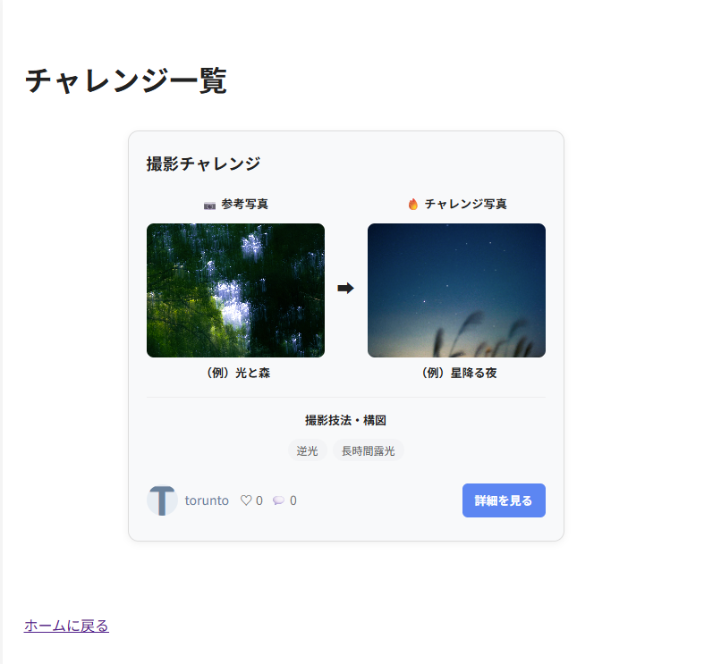
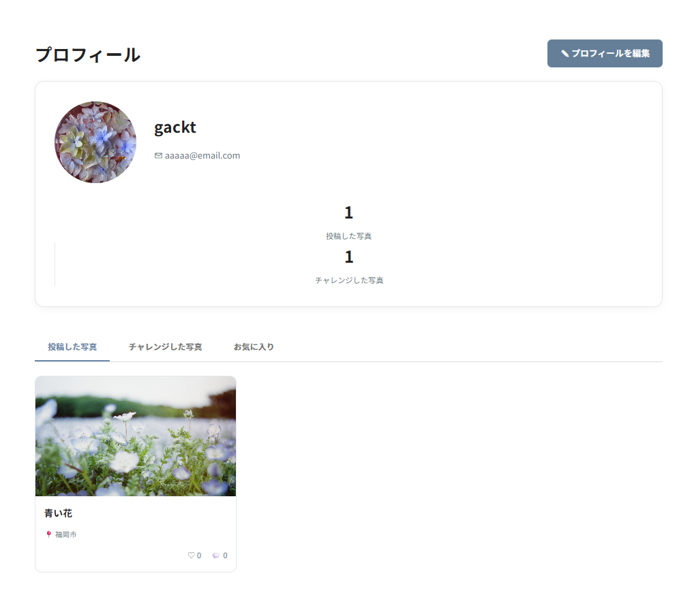

## サービス名 : TORUNTO - 撮らんと？ -

## サービス概要
TORUNTOは、写真を鑑賞するだけでなく、その写真がどのような設定や撮影技法によって生み出されたのかを学べるサービスです。
投稿された写真から撮影時のカメラ設定や使用された撮影技法・構図を確認できるため、写真を見て終わるのではなく、自分自身の撮影に活かすことができます。
また、他のユーザーの写真を参考にして、同じような撮影に挑戦する「撮影チャレンジ」機能を搭載しています。

## このサービスへの思い・作りたい理由
写真を見て「こんな写真を撮ってみたい」と思ったことはありませんか？

SNSなどで魅力的な写真を見つけても、どのような設定で撮影されたのか、どんな技法が使われているのか分からず、自分で再現することが難しいと感じることがあります。

私自身、写真撮影を趣味とする中で、写真を鑑賞するだけでなく、撮影の背景にある技術や工夫を学べる場所があれば、もっと写真撮影を楽しめるのではないかと考えました。

そこで、写真を「視る」だけで終わらせず、撮影技法やカメラ設定を「学び」、実際に自分で「撮る」という体験につなげるサービスとしてTORUNTOを開発しました。

「TORUNTO」は、福岡の方言である「撮らんと？」から名付けました。
「写真を撮らないの？」「撮りに行こうよ」という気軽な呼びかけと、英語の「RUN TO（〜に向かって走る）」を掛け合わせています。

写真撮影への一歩を後押しするサービスを目指しています。

## サービスの利用イメージ

TORUNTOでは、他のユーザーが投稿した写真から撮影設定や撮影技法・構図を学び、実際に自分で撮影することができます。

写真を鑑賞するだけで終わらず、参考写真をもとに撮影へ挑戦することで、写真撮影の知識や表現の幅を広げることを目指しています。

### 1. ログインしてトップページから機能を利用する

ユーザー登録・ログイン後、トップページから写真一覧や写真投稿、撮影チャレンジなどの各機能を利用できます。

### 2. 写真一覧から気になる写真を探す

写真一覧では、他のユーザーが投稿した写真を閲覧できます。

写真だけでなく、投稿者や撮影場所、撮影技法・構図なども確認できるため、気になる写真を見つけるきっかけになります。

### 3. 写真の撮影情報から撮影方法を学ぶ

気になる写真の詳細ページでは、撮影時のカメラ設定や使用された撮影技法・構図を確認できます。
また、ⓘをクリックすると解説が表示されます。

- F値
- ISO感度
- シャッタースピード
- 焦点距離
- 撮影技法・構図

実際に撮影された写真と設定を照らし合わせることで、どのような方法で撮影されたのかを知ることができます。

### 4. 気になる写真を参考に撮影チャレンジに挑戦する

参考にしたい写真を見つけたら、その写真をもとに撮影チャレンジに挑戦できます。

参考写真の撮影設定や撮影技法・構図を確認し、それらを意識しながら実際に撮影します。

撮影した写真はチャレンジ投稿として登録できます。

### 5. 参考写真と自分の写真を比較する

撮影チャレンジ一覧では、参考写真と自分で撮影した写真を並べて確認できます。

同じ写真を目指して撮影しても、撮影環境や設定、撮影者の工夫によって異なる表現が生まれます。

2枚の写真を比較することで、自分の撮影を振り返るきっかけになります。

### 6. プロフィールから過去の投稿を振り返る

プロフィールでは、自分が投稿した写真や撮影チャレンジを確認できます。

過去の作品や撮影設定を見返すことで、自分の撮影経験を振り返ることができます。

## ユーザー層

- 初心者：撮影設定や技法を学び、撮影を始めるきっかけを得られる。
- 中級者：他のユーザーの作品から新しい撮影技法や表現方法を学べる。
- 上級者：自身の知識や撮影技術を共有し、他のユーザーの学習を支援できる。

## サービスの差別化ポイント・推しポイント
　【似たようなサービス】
- 「GANREF ([参考URL](https://ganref.jp/))」: 
  初心者が写真を撮るとは何か、何から学んでいけばいいのか分かる点が差別化点と考えています。
  GANREFさんは機能が非常に多く、総合的な写真コミュニティに位置付けられている印象を持ちます。
  しかし、写真の知識がある程度ないとどうやって撮影したのか、撮影技法がわからない初心者には、
  触れやすいコミュニティではないと感じました。
  本サービスでは、初心者が撮影技法や写真用語を分かりやすく学べるように情報をまとめ、写真撮影を始めるきっかけ 
  と、実際に撮影へ踏み出すための土台を提供します。

- 「500px ([参考URL](https://500px.com/))」: 
  上級者だけでなく初心者も学べる点が差別化点と考えています。
  500pxさんは作品の鑑賞・共有や写真家としての活動に長けていると感じました。
  本サービスでは、上級者だけの世界にせず、カメラを買ったばかりの人でも参加できる写真コミュニティにできます。
  
- 「PHOTOHITO ([参考URL](https://photohito.com/))」: 
  撮影情報を表示するだけではなく、その情報を学習につなげる点が差別化点だと考えています。
  PHOTOHITOさんはカメラ・レンズ・シャッタースピードなど撮影情報が記載されており、
  どのような設定で撮ったのか調べられるという意味では、本アプリと近いです。
  本サービスでは、単に撮影情報を確認するだけでなく、なぜその設定で撮影したのか、
  撮影時に何を意識したのかなど、写真が生まれた過程を知ることができるサービスを目指します。
  ※PHOTOHITOさんは2026年9月30日をもってサービス終了予定と発表されています。

本サービスの推しポイントは、
-  『 写真を見るだけでなく、撮影設定や構図・技法を知り、どう撮ったのかを学べる 』
-  『 F値などの専門用語をクリックするだけで特徴を確認でき、初心者でも迷わず知りたい情報に辿り着ける』
-  『 写真を見る→学ぶ→実際に撮影するという導線を作り、写真を始めるきっかけを提供する』

と考えています。写真やカメラに興味はあるけれど、何から学んでいけばいいのかを解決するものです。
複雑な機能・UIは付けず、初心者から上級者まで使いやすいサービスを目指しています。

## このサービスで提供したい価値
### ユーザーの変化
このサービスを使うことで、ユーザーに以下のような変化を提供します。

  -  行動の変化  

    写真を見るだけで限らず、撮影方法を学び、実際にカメラを持って撮影するようになる。
  
  -  気持ちの変化  
  
    「カメラは難しそう」という気持ちから、「自分もこんな写真を撮ってみたい」という前向きな気持ちになる。
  
  -  考え方の変化  
  
    写真をただ鑑賞するだけでなく「この写真はなぜ綺麗に見えるのか」「どのような設定・構図・技法が使われているのか」
    と、写真を分析して見るようになる。

### 価値を一文で表す
  「写真を見るだけで終わらず、撮影方法を学び、自分でも写真を撮ってみたくなるサービス」
  TORUNTOのコンセプトである、「視る」から「学ぶ」へ。
  を、実現し、最終的に「学ぶ」から「撮る」へつなぎます。

## このアプリで実現すること
- MVPで作る機能
  まずはサービスのコアとなる「写真を視て、撮影について学ぶ」という体験を実現する。

  - ユーザー登録・ログイン・ログアウト
  - プロフィール編集
  - プロフィール画像設定
  - 自分の投稿写真の管理
  - 写真の投稿・編集・削除
  - 写真一覧・詳細表示
  - 撮影設定の登録
      - F値
      - ISO感度
      - シャッタースピード
      - 焦点距離
  - 撮影技法・構図の登録
  - 撮影場所の登録
  - コメント機能
  - お気に入り機能
  - 撮影チャレンジ
      - 参考にした写真を選択する
      - 写真のカメラ設定を確認する
      - 使用されている撮影技法や構図を確認する
      - 参考写真をもとに撮影する
      - 撮影した写真をチャレンジ投稿する
      - 撮影写真と自分の写真を比較する

 

### MVPの推し機能：撮影チャレンジ
TORUNTOの最大の特徴は、他のユーザーが投稿した写真を参考に、実際に同じ撮影技法や構図を意識して撮影に挑戦できる「撮影チャレンジ機能」です。

参考写真に登録されている撮影設定（F値・ISO感度・シャッタースピード・焦点距離）や撮影技法・構図を確認することで、どのような設定や方法で撮影されたのかを学ぶことができます。

さらに、参考写真をもとに自分で撮影した写真を投稿し、参考写真と比較することもできます。

投稿した写真はプロフィールから確認できるため、自分の撮影設定や過去の作品を振り返ることも可能です。

単に写真を鑑賞するだけでなく、他のユーザーの作品から撮影方法を学び、実際に撮影へ挑戦することで、写真撮影の楽しさや表現の幅を広げるきっかけを提供します。

### 撮影チャレンジの流れ

1. 気になる写真を見つける
2. 「🔥この写真でチャレンジする」を選択
3. 参考写真の撮影設定・撮影技法・構図を確認
4. 参考写真をもとに実際に撮影する
5. 撮影した写真を投稿する
6. 参考写真と自分の写真を比較する
7. プロフィールから自分の投稿や撮影設定を振り返る

## 本リリースで作る機能
- MVPで撮影チャレンジを実装し・検証し、ユーザーが「写真を見る→学ぶ→撮ってみる」という体験に価値を感じるか確認する 
- その検証結果を踏まえて、より「学ぶ」体験を充実させる
  - カメラ・レンズ情報の登録機能
  - 撮影スポットの検索機能
  - 撮影技法や構図に関する解説の充実
  - 投稿写真の検索・絞り込み機能
  - ユーザー同士の交流機能の拡充
 

## このアプリの懸念点とその対策
- 懸念点①
  写真SNSとして既存サービスとの差別化が難しい。

  問題になりそうなこと： 
  写真投稿・共有・検索などの機能は、既存の写真サービスにも存在するため、単純な写真SNSとしてはTORUNTO独自の価値を出しにくい。

  なぜそう思うのか： 
  GANREFやPHOTOHITOなど、写真の投稿・閲覧や、撮影情報の確認ができるサービスがすでに存在しているため。

  そのために考えている対策： 
  写真を投稿するだけでなく、「写真から撮影方法を学ぶ」ことをサービスの中心にする。 
  例えば、写真に表示された「F値」を押すことで、

  - F値とは？
  - F値を小さくするとどうなる？
  - この写真ではなぜこのF値を使っている？
  
　といった情報を確認できるようにし、単なる撮影情報ではなく学習につなげる情報として提供する。

- 懸念点②
  情報量が多くなり、初心者には分かりくくなる可能性がある。

  何が問題になりそうか： 
  カメラにはF値、ISO感度、シャッタースピード、焦点距離など多くの専門用語があり、情報を詰め込みすぎると初心者が使いにくくなる。

  なぜそう思うのか： 
  「初心者でも写真を見ながら学べる」というTORUNTOの目的と、情報量の多さが矛盾する可能性があるため。
  
  そのために考えている対策： 
  シンプルなUIと分かりやすい導線を意識する。 
  例えば、「F2.8」という項目をクリックすると、 

    F値とは？ 
    レンズの絞り具合を表す数値。 
    数値が小さいほど背景をぼかしやすくなります。 

  というように、その場で簡単に理解できる設計にする。
  「知りたい情報を押すだけで分かる」UIにすることで、初心者でも迷わず利用できるようにする。

## 今後の展開・発展の方向性
- 観点 

  ユーザーはなぜ使い続ける？ 
  自分が撮りたい写真の撮影方法を調べたり、他のユーザーの写真から新しい技法を学んだりできるため。
  また、自分の写真を投稿することで、他のユーザーに知識や撮影方法を共有することもできる。

  続けることで何が変わる？ 
  写真を見るだけだったユーザーが、撮影技法やカメラの知識を身に着け、実際に撮影するようになる。
  さらに、撮影経験が増えることで、より高度な撮影技法やRAW現像、フィルムカメラなど、
  新しい写真表現にも挑戦できるようになる。

  データが溜まると何ができる？ 
  写真・撮影設定・撮影技法・撮影場所などのデータが蓄積されることで、
  - 撮影技法から写真を探す
  - 撮影スポットから写真を探す
  - 「玉ボケを使った写真」など、撮りたい表現から探す
  - 自分が学んだ撮影技法を管理する

 といった機能への発展が考えられる。

  他の人と関わる余地がある？ 
  上級者が撮影技法や撮影スポットを共有し、初心者・中堅者がそこから学ぶことで、ユーザー同士の知識共有につなげる。

- 今考えている発展案 

  機能追加の方向性：
   - 撮影スポット検索
   - 撮影技法・構図の解説
   - カメラ・レンズ情報
   - RAW現像やフィルムカメラなど、より専門的な情報の追加

  UI・体験の改善：
   - 初心者でも直感的に操作できるシンプルなUI
   - 情報を必要以上に表示せず、クリックすることで詳細を確認できる設計
   - 「視る→学ぶ→撮る」の導線をより分かりやすくする

  機能以外の工夫：
   - ユーザー同士が撮影方法を教え合える環境を作る
   - 初心者から上級者まで、それぞれのレベルに合った学びを提供する

  ## 技術スタック
  - 使用予定の技術 

  | カテゴリ | 技術構成 |
  | ---- | :--- |
  | フロントエンド | HTML / CSS / JavaScript / Hotwire（Turbo・Stimulus）|
  | バックエンド | Ruby 3.3.5 / Ruby on Rails 7.2 |
  | データベース | PostgreSQL |
  | 画像管理 | Acitve Storage |
  | 認証 | Devise |
  | 開発環境 | WSL / Docker |
  | テスト | Rspec |
  | バージョン管理 | Git / Github |
  | CI/CD | GitHub Actions |
  | デプロイ | Render |

  【選定理由】
  メインの技術であるRails、Ruby、データベース、デプロイサーバーを選定した理由を簡単に述べます。
  - Ruby / Ruby on Rails ：
    Ruby on Railsを採用しました。 
    ユーザー登録、写真投稿、コメント、いいね、撮影情報の管理など、データベースと連携したWebアプリケーションを効率的に開発できるためです。
    また、現在学習しているRuby on Railsの知識を活かしながら、MVC構造やRESTfulな設計について理解を深めることも目的としています。

  - データベース ：
    PostgreSQLを採用しました。 
    ユーザー情報や写真、撮影設定、撮影技法、コメントなど、TORUNTOでは多くのデータを関連付けて管理する必要があります。
    PostgreSQLはリレーショナルデータベースとして複雑なデータの関連付けに適しており、MySQLと比較しより複雑なデータの扱いに強いPostgreSQL採用しました。
  
  - デプロイサーバー ：
    Renderを採用しました。 
    同水準のサーバー候補として、Herokuと比較検討しましたが、今回のサービス規模においてコスト面でRenderが適していると考えました。
    加えて、RailsアプリケーションやPostgreSQLとの連携を比較的容易に構築でき、個人開発でのデプロイ先として扱いやすいため採用します。

  ## 画面遷移図
  https://www.figma.com/design/UfiHb5E5J9LDUuOteODs3H/TORUNTO?node-id=0-1&p=f&m=draw

  ## ER図
  https://dbdiagram.io/d/TORUNTO-6ab48e4a0f25a52d01f00335